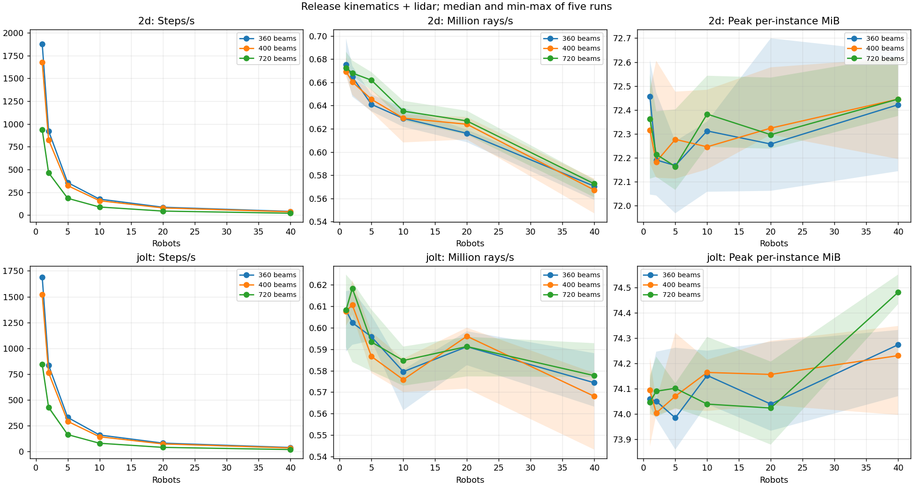
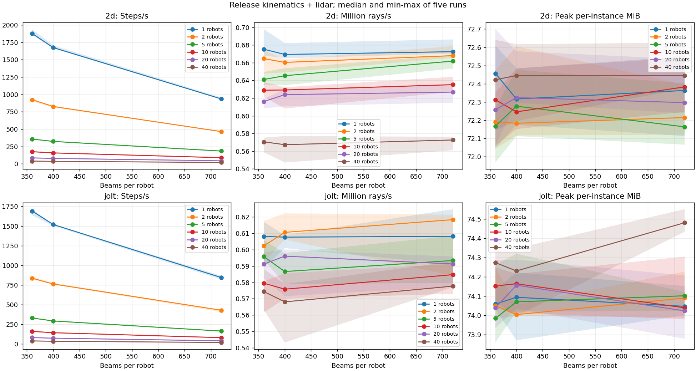
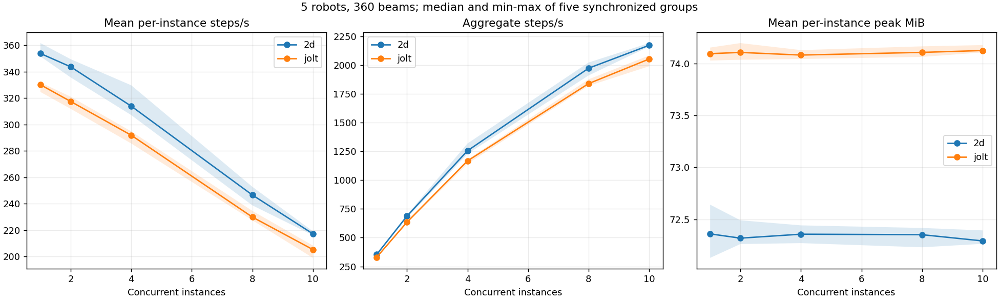

# Milestone 3 stage 1 benchmark

## Outcome

The project-brief rule recommends **Jolt 3D**. Both kernels are retained;
human confirmation is required before removing either kernel. No stage 2 is implemented.

The recorded dataset used **STATIC robot query bodies**.
Current body-mode semantics and post-review validation are documented in
`docs/robot-spec.md`; the measurements below describe this recorded dataset.

At 5 robots and 360 beams, the single-instance target is median >= 200 steps/s:

| Backend | Steps/s median [min, max] | Target met | Peak MiB median [min, max] |
| --- | --- | --- | --- |
| 2d | 356.1 [352.8, 360.9] | True | 72.2 [72.0, 72.3] |
| jolt | 331.0 [330.0, 336.5] | True | 74.0 [73.9, 74.3] |

The headroom comparison uses 360 beams:

| Robots | 2D median steps/s | Jolt median steps/s | Jolt / 2D | 70% threshold tie |
| --- | --- | --- | --- | --- |
| 5 | 356.12 | 330.99 | 92.94% | False |
| 20 | 85.57 | 82.10 | 95.95% | False |

The 200 steps/s qualification uses the median exactly. Spread is the observed
minimum-to-maximum interval of five runs. For the 70% comparison, overlapping
Jolt and 0.7-times-2D intervals count as a tie; if needed, median peak memory at
the 5-robot/360-beam target condition resolves it. This is an operational
interpretation of the brief's spread rule, not a statistical confidence interval.

## Machine and build

| Item | Value |
| --- | --- |
| CPU | 12th Gen Intel(R) Core(TM) i5-12600K |
| Cores | 10 physical, 16 logical |
| OS-visible RAM | 34088538112 bytes (31.75 GiB) |
| OS | Microsoft Windows 11 Home 10.0.26300 |
| Platform API | Windows-10-10.0.26300-SP0 |
| Godot | 4.7.1.stable.official.a13da4feb |
| Compiler | g++ (Rev2, Built by MSYS2 project) 13.2.0 |
| CMake | cmake version 3.28.2 |
| Python | 3.11.6 |
| Baseline commit | `16735f64db5b1bf8734dd13a7ab6d1e3e34064dc` plus this M3 change |
| Release template SHA-256 | `76269a403bb832599edeee4432a5b7a7e88c018eb5c9c798dfd8289359b0ec07` |
| Exported executable SHA-256 | `04baf75cc1d69dd93eb709533ecab4fd7770bb8a530645717017a06a9d9809fc` |
| Exported resource pack SHA-256 | `30a8520697e79567af09c55ca8bc347255a51c1336ba2f3245509c53ae8b72a2` |
| Native library SHA-256 | `00667d986dab19237ccb5bff310739f7193d51ac80b415e9e1b31d650bb03358` |

The extension is built with CMAKE_BUILD_TYPE=Release and GODOTCPP_TARGET=template_release.
Each worker asserts it is an exported, non-debug, non-editor runtime and that
the C++ kinematics class is loaded. Both backends run under the same project
configuration: GodotPhysics2D and Jolt Physics. No affinity or scheduling
priority is imposed; this hybrid CPU's P/E cores and normal OS scheduling can
affect parallel scaling. Linux M3 throughput has not been measured.

## Workload and measurement

The deterministic compiler-generated stress map contains 326 rectangular walls:
a 160 m corridor 4 m wide with 40 rooms per side, door openings, outer walls,
partitions, end caps, and 80 boxes alternating above/below the scan plane.
The full primitive input is identical for both kernels. 2D filters the 80
off-plane walls at load time; Jolt keeps their 3D geometry. Neither backend
uses analytic intersection code. Robots retain the A100's true 0.27 m radius
and 0-0.25 m body height; every robot scans every step and can hit teammates.

Each run warms up for 50 steps, then measures for at least 2.0 wall-clock seconds.
Benchmark-only dt = 0.05 s is supplied in each worker configuration;
it does not select the project's control rate. Precomputed deterministic
sinusoidal linear commands (200-step period, 0.5 m/s amplitude, distinct
per-robot phases, zero angular velocity) keep motion bounded. The existing
C++ integrator updates all poses and previous velocities on every step.

Timed work includes the native kinematics call, state/snapshot updates,
query-body synchronization, snapshot validation, all ray calls, and
construction of scan arrays and metadata. Pose integration and sensing run
inside one physics-safe callback; motion is kinematic and bodies have zero
contact masks. Steps/s is steps divided by accumulated timed work; rays/s is
steps/s times robot count times beam count. Timer resolution is one microsecond.
This is a **lower bound on per-step cost**: export/load/warmup, command-table
generation, outer loop/timer overhead, result checksums, file I/O, rendering,
regular frame scheduling, collision handling, transport, policy inference,
noise, and pedestrians are outside the timed interval. Raw results also
record whole-loop wall rates to expose any timing-overhead difference.

Peak per-instance memory is the process OS high-water resident set, not a
Godot allocator counter: Windows peak_wset, Linux VmHWM. It includes startup,
engine, extension, map, warmup, and measured work. Workers remain alive until
the parent reads this counter; memory is not estimated from sparse samples.
Five fresh processes run per single condition. Backend order alternates
between repeats to reduce order bias. Results and fixtures stay under tmp/.

Parallel groups warm up independently, then start from one file barrier.
All group members must finish before peak memory is read. Each count has
five fresh groups per backend. Per-instance rate is the group arithmetic
mean; aggregate rate is the sum of member rates, followed by median/min/max
across groups. These remain query-plus-kinematics capacity estimates, not
end-to-end trainer throughput. No cores are reserved for a Python trainer
in this saturation experiment. Every individual worker result is retained.

Functional tests independently check geometry, metadata, mount composition,
height/range boundaries, self exclusion, immediate robot movement/removal,
and deliberately wrong expectations. Stress parity covers N=1,5,20,40, all
three beam counts and three snapshots, with <=1e-4 m finite-range difference
and identical infinity classes. M1/M2 tests also run with Jolt enabled.

Implementation validation: all 50 unittest tests passed.
The release benchmark asserts exported release execution and native kinematics
loading in every worker.

## Single-instance results

Values are median [minimum, maximum] over five runs.

| Backend | Robots | Beams | Steps/s | Million rays/s | Peak MiB |
| --- | --- | --- | --- | --- | --- |
| 2d | 1 | 360 | 1875.9 [1856.1, 1938.8] | 0.675 [0.668, 0.698] | 72.5 [72.0, 72.6] |
| jolt | 1 | 360 | 1689.2 [1635.8, 1713.9] | 0.608 [0.589, 0.617] | 74.1 [74.0, 74.1] |
| 2d | 2 | 360 | 923.1 [899.5, 936.3] | 0.665 [0.648, 0.674] | 72.2 [72.0, 72.5] |
| jolt | 2 | 360 | 836.6 [822.3, 857.7] | 0.602 [0.592, 0.618] | 74.1 [74.0, 74.2] |
| 2d | 5 | 360 | 356.1 [352.8, 360.9] | 0.641 [0.635, 0.650] | 72.2 [72.0, 72.3] |
| jolt | 5 | 360 | 331.0 [330.0, 336.5] | 0.596 [0.594, 0.606] | 74.0 [73.9, 74.3] |
| 2d | 10 | 360 | 174.7 [172.7, 177.3] | 0.629 [0.622, 0.638] | 72.3 [72.1, 72.4] |
| jolt | 10 | 360 | 161.0 [156.0, 161.3] | 0.580 [0.562, 0.581] | 74.2 [74.0, 74.2] |
| 2d | 20 | 360 | 85.6 [84.5, 86.0] | 0.616 [0.608, 0.619] | 72.3 [72.1, 72.7] |
| jolt | 20 | 360 | 82.1 [80.9, 83.1] | 0.591 [0.583, 0.598] | 74.0 [73.9, 74.3] |
| 2d | 40 | 360 | 39.6 [38.8, 39.9] | 0.571 [0.559, 0.575] | 72.4 [72.1, 72.6] |
| jolt | 40 | 360 | 39.9 [39.1, 40.8] | 0.574 [0.563, 0.588] | 74.3 [74.1, 74.3] |
| 2d | 1 | 400 | 1673.4 [1662.8, 1705.7] | 0.669 [0.665, 0.682] | 72.3 [72.2, 72.5] |
| jolt | 1 | 400 | 1519.1 [1502.3, 1522.2] | 0.608 [0.601, 0.609] | 74.1 [73.9, 74.2] |
| 2d | 2 | 400 | 825.5 [811.4, 829.3] | 0.660 [0.649, 0.663] | 72.2 [72.1, 72.6] |
| jolt | 2 | 400 | 763.2 [757.7, 777.7] | 0.611 [0.606, 0.622] | 74.0 [74.0, 74.1] |
| 2d | 5 | 400 | 322.7 [317.3, 326.9] | 0.645 [0.635, 0.654] | 72.3 [72.1, 72.5] |
| jolt | 5 | 400 | 293.3 [289.5, 299.0] | 0.587 [0.579, 0.598] | 74.1 [74.0, 74.3] |
| 2d | 10 | 400 | 157.3 [152.1, 158.1] | 0.629 [0.608, 0.632] | 72.2 [72.2, 72.5] |
| jolt | 10 | 400 | 144.0 [142.5, 146.4] | 0.576 [0.570, 0.586] | 74.2 [74.0, 74.2] |
| 2d | 20 | 400 | 78.0 [76.3, 78.8] | 0.624 [0.611, 0.630] | 72.3 [72.3, 72.6] |
| jolt | 20 | 400 | 74.5 [71.5, 75.0] | 0.596 [0.572, 0.600] | 74.2 [74.0, 74.3] |
| 2d | 40 | 400 | 35.5 [34.2, 36.1] | 0.567 [0.547, 0.577] | 72.4 [72.2, 72.6] |
| jolt | 40 | 400 | 35.5 [34.0, 36.2] | 0.568 [0.543, 0.579] | 74.2 [74.0, 74.3] |
| 2d | 1 | 720 | 934.0 [931.0, 953.2] | 0.672 [0.670, 0.686] | 72.4 [72.1, 72.6] |
| jolt | 1 | 720 | 844.7 [820.8, 867.7] | 0.608 [0.591, 0.625] | 74.0 [74.0, 74.2] |
| 2d | 2 | 720 | 463.9 [462.2, 471.4] | 0.668 [0.666, 0.679] | 72.2 [72.1, 72.4] |
| jolt | 2 | 720 | 429.4 [405.6, 431.5] | 0.618 [0.584, 0.621] | 74.1 [74.0, 74.2] |
| 2d | 5 | 720 | 183.8 [181.5, 185.8] | 0.662 [0.653, 0.669] | 72.2 [72.1, 72.4] |
| jolt | 5 | 720 | 164.8 [161.0, 169.0] | 0.593 [0.580, 0.608] | 74.1 [74.0, 74.1] |
| 2d | 10 | 720 | 88.2 [87.1, 89.5] | 0.635 [0.627, 0.644] | 72.4 [72.2, 72.5] |
| jolt | 10 | 720 | 81.2 [79.6, 82.1] | 0.585 [0.573, 0.591] | 74.0 [74.0, 74.3] |
| 2d | 20 | 720 | 43.5 [42.7, 44.1] | 0.627 [0.615, 0.636] | 72.3 [72.2, 72.5] |
| jolt | 20 | 720 | 41.1 [40.1, 41.4] | 0.591 [0.577, 0.596] | 74.0 [73.9, 74.2] |
| 2d | 40 | 720 | 19.9 [19.5, 20.0] | 0.573 [0.561, 0.576] | 72.4 [72.4, 72.6] |
| jolt | 40 | 720 | 20.1 [20.0, 20.6] | 0.578 [0.577, 0.593] | 74.5 [74.4, 74.6] |





## Parallel scaling

Each instance has 5 robots and 360 beams. Values are median [min, max] across five groups.

| Backend | Instances | Mean per-instance steps/s | Aggregate steps/s | Mean per-instance peak MiB |
| --- | --- | --- | --- | --- |
| 2d | 1 | 353.9 [351.6, 361.7] | 353.9 [351.6, 361.7] | 72.4 [72.1, 72.6] |
| jolt | 1 | 330.2 [324.7, 331.9] | 330.2 [324.7, 331.9] | 74.1 [74.0, 74.2] |
| 2d | 2 | 343.7 [335.7, 349.5] | 687.5 [671.5, 699.1] | 72.3 [72.3, 72.5] |
| jolt | 2 | 317.5 [311.9, 321.1] | 635.0 [623.9, 642.3] | 74.1 [74.0, 74.2] |
| 2d | 4 | 314.0 [307.2, 329.8] | 1255.9 [1228.7, 1319.1] | 72.4 [72.3, 72.4] |
| jolt | 4 | 291.9 [285.7, 294.9] | 1167.7 [1142.8, 1179.5] | 74.1 [74.0, 74.1] |
| 2d | 8 | 246.7 [238.8, 252.9] | 1973.4 [1910.7, 2023.2] | 72.4 [72.2, 72.4] |
| jolt | 8 | 230.0 [227.5, 234.6] | 1839.7 [1820.3, 1877.1] | 74.1 [74.1, 74.2] |
| 2d | 10 | 217.3 [216.2, 219.2] | 2172.7 [2161.7, 2191.9] | 72.3 [72.3, 72.4] |
| jolt | 10 | 205.3 [199.1, 208.4] | 2053.4 [1990.6, 2084.0] | 74.1 [74.1, 74.2] |



## Reproduction

From the repository root, with a matching Godot editor and official release
export template installed (or an extracted template passed explicitly):

```powershell
cmake -S native -B build/native -G "MinGW Makefiles" -DCMAKE_BUILD_TYPE=Release -DGODOTCPP_TARGET=template_release
cmake --build build/native --parallel 4
python -m assets.build_robot spec/robots/a100.yaml
python -m unittest discover -s tests -v
python -m tools.benchmark_m3 --release-template tmp/tools/templates/windows_release_x86_64.exe --output tmp/m3-results-20261107
python -m tools.report_m3 tmp/m3-results-20261107/results.json
```

Set GODOT_BIN to the Godot console/editor executable, as in README. The exact
measured run used the commands above on Windows. The explicit template was
extracted from the official 4.7.1-stable export-templates archive, not built
from editor sources. The exporter stages sim/ under the output directory and
selects the benchmark scene there; the tracked project's main scene is unchanged.
Use a new output directory for a new run. The report renderer requires matplotlib
(validated with 3.8.2); benchmark execution only needs requirements.txt.

Linux: build using docs/native-build.md, set GODOT_BIN, and run the same module
with --release-template pointing to linux_release.x86_64. The Linux preset and
VmHWM measurement path are supplied but remain unvalidated for M3. Installed
templates can be used by omitting --release-template. A smoke export can be
checked with --smoke --seconds 0.3; smoke results are rejected by the report renderer.

Local raw results: `tmp/m3-results-20261107/results.json`. This includes every
worker's config, log, output and OS peak bytes in aggregate JSON. Fixtures,
staged exports, native binaries, and raw benchmark JSON are ignored by Git.

## Changed files

The existing M3 target/decision-rule edits in the brief and design context
are preserved and included. Current implementation/status descriptions are
updated for stage 1. Godot-generated resource UIDs are tracked.

Contracts and compiler:

- `spec/robot.schema.yaml`
- `spec/robots/a100.yaml`
- `assets/build_robot.py`
- `sim/generated/robots/a100.json`

Query runtime:

- `sim/project.godot`
- `sim/bridge/frames.gd`
- `sim/sensors/lidar_kernel.gd`
- `sim/sensors/lidar_kernel.gd.uid`
- `sim/native/cadence.gdextension.uid`

Release benchmark:

- `sim/export_presets.cfg`
- `sim/benchmarks/benchmark.gd`
- `sim/benchmarks/benchmark.gd.uid`
- `sim/benchmarks/benchmark.tscn`
- `tools/__init__.py`
- `tools/m3_fixtures.py`
- `tools/benchmark_m3.py`
- `tools/report_m3.py`
- `requirements.txt`

Tests:

- `tests/test_robot_compiler.py`
- `tests/test_milestone3.py`
- `tests/test_benchmark_m3.py`
- `sim/tests/lidar_test.gd`
- `sim/tests/lidar_test.gd.uid`

Documentation:

- `README.md`
- `docs/robot-spec.md`
- `docs/project-brief.md`
- `docs/design-context.md`
- `docs/benchmark-m3.md`
- `docs/figures/m3-count.png`
- `docs/figures/m3-beams.png`
- `docs/figures/m3-parallel.png`
